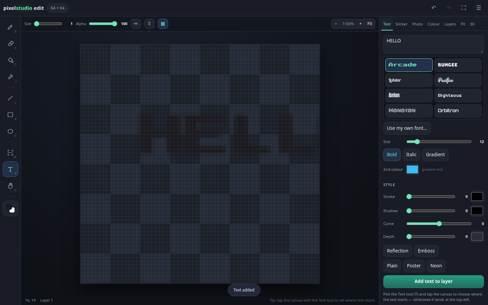

# Pixel Studio Edit

A free, open-source pixel art **and text** editor that runs entirely in your browser. No install, no account, no uploads — every pixel stays on your machine.

**Live editor:** [galeoindus.github.io/pixelstudioedit](https://galeoindus.github.io/pixelstudioedit/)



## Why it exists

Most pixel editors are desktop-only or locked behind a subscription, and most "text on photo" apps are ad-supported. Pixel Studio Edit is a single static site: open `index.html` and start drawing or typing. The feature set follows what people expect from a mobile pixel-art editor — layers, 3D text, stickers, gradients, palettes, background removal — but the code and assets are new and MIT licensed.

## Interface

The app opens on a **start screen** with the three jobs it is built for — Create a design, Edit a photo, Make pixel art — so a first-time visitor knows where to begin. All three land in the same editor, on the same artboard, with the same layers, history and export.

Everything is organised around one canvas:

- **Left rail** — eleven named tools (Pen, Erase, Fill, Pick, Line, Rect, Oval, Select, Crop, Text, Pan), each with its keyboard shortcut. The colour chip at the bottom swaps primary/secondary.
- **Quick bar** — brush size, opacity, mirror X/Y and the pixel grid, always within reach while drawing.
- **Right panel** (bottom sheet on phones) — seven tabs: **Text, Sticker, Photo, Colour, Layers, FX, 3D**. One panel at a time, so nothing is buried in a collapsed accordion.
- **Save status** in the top bar tells you whether the project is saved, unsaved or autosaved.
- **Canvas chip** in the top bar — size, resize, flip and rotate. **New document** offers banner and social templates (Instagram 1080, Story 1080×1920, YouTube 1280×720, Banner 1500×500, Meme 800×600, Poster 1080×1350).
- **Full-screen canvas** — the ⛶ button hides every panel for distraction-free drawing (and asks the browser for real full screen).
- **File menu** — New, Open, Save, Import image, Export PNG, Canvas, Restore autosave, Shortcuts.

## Features

**Text**
- **Tap the canvas with the Text tool and a floating text box opens right there** — type, press Enter, done
- **Use your own font**: drop in any `.ttf`, `.otf`, `.woff` or `.woff2` file and it appears in the font list
- Multiple lines, **16 fonts shown in their own typeface** (open-licence web fonts: Press Start 2P, Bungee, Lobster, Pacifico, Anton, Righteous, Monoton, Orbitron, Bebas Neue, Caveat, Fredoka, Cinzel plus system classics)
- Fill with a solid colour **or a linear gradient** between two colours
- Stroke (outline), drop shadow, curved text, emboss and reflection
- **3D text**: extruded depth with adjustable angle, side colour and auto shading
- Style presets: Plain, Poster, Neon

**Photo tools** — one tap, no upload
- **Make pixel art**: shrink into blocks and snap to the chosen palette, with optional dithering
- **Scale** 25% / 50% / 200% / 400% and **crop to selection**
- **Auto background removal** (samples the corners), remove white, or remove the primary colour
- **B&W, sepia, sharpen**, and **use image colours as palette** (extracts the dominant colours)

**Stickers**
- 40 built-in shapes and emoji, adjustable size, placed at the tap anchor or centred

**Drawing**
- Pencil, eraser, fill bucket, line, rectangle, ellipse, eyedropper, rectangular select + move, text, pan
- Brush size 1–24 px, opacity, fill tolerance, filled or outlined shapes
- Mirror on X, Y, or both; pixel grid; transparency checkerboard; right-click draws with the secondary colour

**Layers**
- Unlimited layers: visibility, lock, rename, reorder, duplicate, delete, merge down, clear
- Per-layer opacity and live thumbnails

**Colour and background**
- Primary/secondary colours, hex field, native picker
- Palettes: DawnBringer 16, PICO-8, Sweetie 16, Game Boy, NES, Grayscale 8, Sepia 8 — or build your own
- Background fill in a solid colour or a gradient

**Effects**
- Live brightness, contrast, saturation and hue with apply/reset
- Invert, grayscale, posterize, threshold, blur, noise, **vignette, stripes**, outline, drop shadow
- **Remove background** by colour or by white, with a tolerance slider
- Palette reduction plus Floyd–Steinberg and ordered/Bayer dithering

**3D image**
- Turn, tilt (perspective projection) and extrude the active layer

**Files**
- Export **PNG, JPEG or WebP** at 1×–20× with nearest-neighbour upscaling and a quality slider
- Save/open projects as `.json` (layers preserved), import images onto a new layer
- Autosave to local storage, restorable at any time

## Getting started

Open `index.html` in a browser — no build step, no dependencies.

To run it locally with a server (recommended, so autosave and file APIs behave predictably):

```bash
git clone https://github.com/galeoindus/pixelstudioedit.git
cd pixelstudioedit
python3 -m http.server 8000
# then open http://localhost:8000
```

## Keyboard shortcuts

| Key | Action | Key | Action |
| --- | --- | --- | --- |
| `B` | Pencil | `I` | Eyedropper |
| `E` | Eraser | `M` | Select & move |
| `G` | Fill bucket | `T` | Text |
| `L` | Line | `H` | Pan |
| `R` | Rectangle | `X` | Swap colours |
| `O` | Ellipse | `[` `]` | Brush size |
| `C` | Crop | `Esc` | Deselect |
| `+` `-` | Zoom | `0` | Fit to screen |
| `Ctrl+Z` | Undo | `Ctrl+Shift+Z` | Redo |
| `Ctrl+A` | Select all | `Delete` | Clear selection |

## Project layout

```
index.html          markup: rail, quick bar, canvas, tabbed panels
css/style.css       the whole UI, including the mobile bottom sheet
js/core.js          pure image routines: colour maths, effects, dithering, 3D, photo tools (no DOM)
js/app.js           editor: tools, layers, text styling, stickers, history, file IO
tests/core.test.js  unit tests for js/core.js
tests/ui.js         headless browser test: boots the app and drives every control
docs/preview.png    screenshot used above
```

`js/core.js` has no DOM dependency, so the image maths runs in Node:

```bash
node tests/core.test.js
```

The UI test drives a real Chromium through puppeteer and checks that every tool, panel and button actually does something:

```bash
npm i puppeteer-core          # or use an existing install
CHROME_PATH=/usr/bin/chromium node tests/ui.js
```

## Contributing

Issues and pull requests are welcome. Keep `js/core.js` free of DOM access so the tests stay runnable, and add a test for any new effect. Image routines must copy into `ImageData.data` rather than reassign it — browsers make that property read-only.

## Licence

MIT — see [LICENSE](LICENSE).

Pixel Studio Edit is an independent project. It is not affiliated with, endorsed by, or derived from the source code or assets of any commercial pixel-art app.
